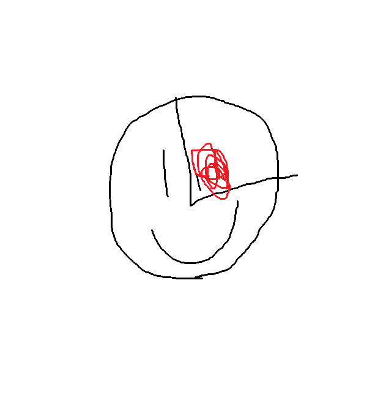

hey there, xander here, so i made this website as a joke, its a website to a fictitional ai im building, the ai still en progress but the webpage its deployed, i used phrases like a real ai would use, but with a bit of absurdism

for the website i used pure html and css, also i imported some google fonts to add profesionalism, and used a background gradient generator to generate the blue gradient, i used my knowledge in html to make this, and the fun part is that i used paint to "design" the logo and the benchmark

.png)

my inspiration for this was the actual ai website like gpt or fable, but i wanted to add a comic presentation exagerating the stats and real usage

.png)

the features included in the website are diferent sections with various info about it, the benchmark button that only pops up the message, the button that does absolutely nothing but is nice having it there, 

.png)

